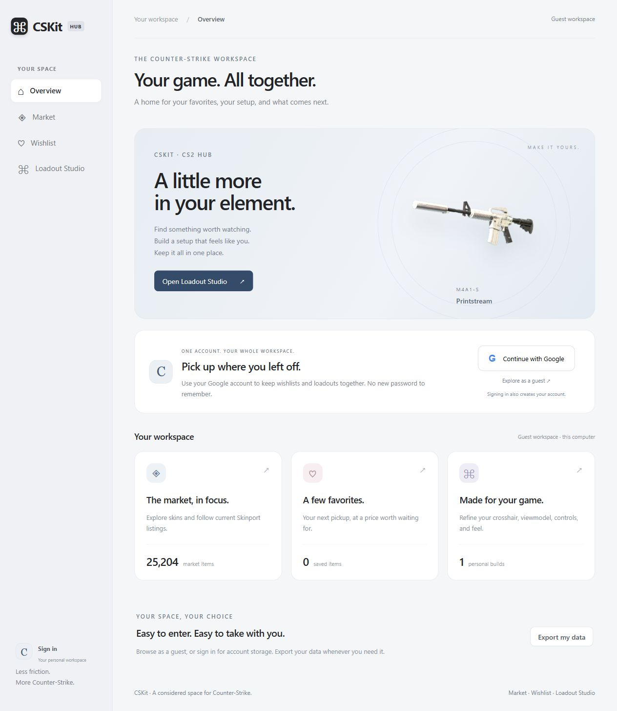
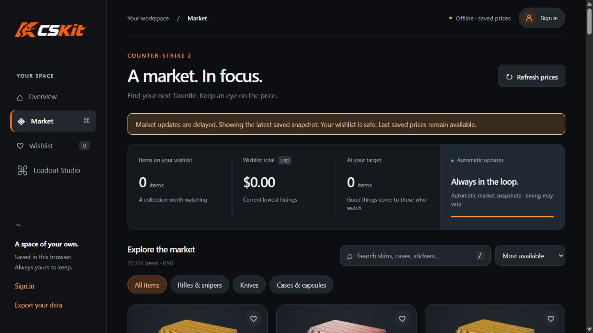
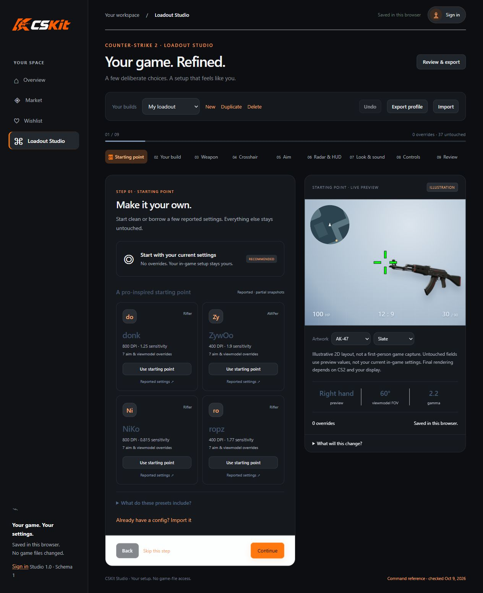

<div align="center">

# CSKit

### Your game. All together.

A lightweight CS2 Hub with a market tracker, personal wishlist, Loadout Studio, and optional Google accounts through Firebase.

**[Open CSKit.site](https://cskit.site) · Google sign-in · Private account storage · Loadout Studio**

</div>



## One workspace for your game

The new overview brings Market, Wishlist, and Loadout Studio together. **Continue with Google** signs in or creates an account without a new password. When Firebase is configured, wishlists and builds are saved to your own Firestore documents. On the website, guest work stays in your own browser. The optional desktop server keeps its original local JSON storage.

Existing data is never uploaded automatically: after signing in, use **Bring local data to my account** to copy your guest wishlist and builds. Cloud entries win on duplicates, and local originals remain intact.

The public app runs on Firebase Hosting with automatic HTTPS. [Deployment and domain setup](docs/DEPLOYMENT.md) · [Firebase accounts and storage](docs/FIREBASE.md). New desktop clones run in guest mode until a Firebase web configuration is supplied.



_Actual app screenshot. Prices shown are a snapshot, not current quotes._

## Your next favorites, in focus

- Search skins, cases, stickers, and more; filter categories and sort prices.
- Save a wishlist, set target prices, and see when listings meet your targets.
- Explore transparent artwork with hover tilt, soft shadows, and floating HD previews.
- Browse the latest public market snapshot; the optional desktop tracker also keeps up to 90 days of local price observations.
- Refresh the public Skinport feed through a scheduled GitHub job, requested every five minutes. GitHub scheduling and CDN caching can delay updates; the UI shows snapshot time and flags stale prices.
- Save guest wishlist and builds in your browser, or sync them privately using Google sign-in.

Responsive layouts support smaller windows. Reduced-motion preferences disable animation.

## Loadout Studio

Open **Loadout Studio** in the sidebar to create a personal CS2 settings profile in the same calm workspace.



- Nine steps cover a starting point, profile name, weapon placement, crosshair, sensitivity, radar/HUD, brightness/audio, keybinds, and export.
- Every setting starts at **Keep current**. Only explicit overrides enter your `autoexec.cfg`; zero is a real value.
- Save multiple profiles, duplicate them, undo edits, and import/export Studio JSON or recognized config commands.
- Preview relative weapon placement, crosshair shape, HUD color, radar, and brightness. Previews are illustrative 2D layouts, not an exact first-person CS2 renderer; untouched settings use reference values.
- Review changes, download a config, follow installation instructions, and check pasted console output for common loading errors.

The app never reads or writes your game files. It cannot discover your existing binds or verify in-game execution. Key replacements require acknowledgment; duplicate keys block config export. Unknown commands, aliases, scripts, and legacy crosshair commands are skipped on import with a report.

Command support is a curated snapshot checked **October 9, 2026** against the [SteamTracking CS2 convar dump](https://github.com/SteamTracking/GameTracking-CS2/blob/master/DumpSource2/convars.txt). It uses the current crosshair length/gap/thickness/opacity commands. A future game update can change command behavior; this registry does not update automatically. Market refresh remains automatic.

Pro-inspired choices are seven-field aim/viewmodel snapshots from [ProSettings](https://prosettings.net/), with links in the app. They are partial reported settings, not endorsements or verified current configurations. Observed October 9; source pages displayed October 10, 2026, an unresolved date discrepancy disclosed in the UI. Custom edits take precedence.

## Publish updates

Push to `main` to run tests, build, and deploy Firebase Hosting through the **Publish CSKit** workflow. GitHub authenticates with a short-lived, repository-and-branch-restricted identity; no service-account key is stored. The separate **Refresh market feed** workflow updates public market data without redeploying the website.

## Desktop quick start

Install [Node.js 22 or newer](https://nodejs.org/), then:

```sh
git clone https://github.com/DallenLarson/cs2-atelier.git
cd cs2-atelier
npm start
```

Open **http://127.0.0.1:43127**. No package installation or build step is needed.

The first launch downloads market prices and the artwork catalog. Images load as you browse and cache locally. Fresh data requires an internet connection.

### Windows background mode

Run from PowerShell in the project folder:

```powershell
# Launch quietly and open the app
& '.\Start Atelier.ps1'
# Optional: launch at Windows sign-in
& '.\Enable automatic startup.ps1'
# Stop the background process
& '.\Stop Atelier.ps1'
# Remove automatic sign-in launch
& '.\Disable automatic startup.ps1'
```

Scripts follow your PowerShell execution policy. You can always use `npm start` in a terminal instead. Automatic startup is opt-in for new installations. Keep the project folder in place after enabling it.

Your computer must be awake and online for fresh prices. Offline mode retains the last successful prices and retries automatically. Manual refresh respects the same five-minute interval.

## Local by design

| File                 | Contents                          |
| -------------------- | --------------------------------- |
| `data/wishlist.json` | Saved items and target prices     |
| `data/market.json`   | Cached market prices              |
| `data/history.json`  | Price observations                |
| `data/studio.json`   | Loadout profiles and active build |
| `data/artwork.json`  | Artwork catalog                   |
| `data/images/`       | Cached transparent images         |

The `data/` folder, machine-specific shortcuts, and runtime paths are ignored by Git. The server listens only on `127.0.0.1`. Guest mode requires no account. Signing in uses Firebase Authentication and private Firestore storage; no analytics is loaded.

For a complete backup, stop the app and copy `data/`. Restore by stopping the app and replacing that folder with your backup. **Export your data** downloads wishlist, history, and the Studio library as JSON; importing that combined backup through the interface is not currently supported. Studio's **Export profile** produces an individually importable JSON file.

## What to expect

- Prices are Skinport's lowest tradable listings in **USD**, not Steam wallet prices or completed sales. Missing prices show a dash.
- Target matches appear inside the app; there are no OS push notifications.
- Charts record observations while the process runs. They do not backfill historical data.
- Artwork is a representative 2D render, not a 3D inspection or an exact float/pattern preview. Large previews request 1024 × 768 images where supported.
- Missing artwork falls back to text. Some new items may not have matching images yet.

## Development

Plain HTML, CSS, and JavaScript with a small Node.js server. No framework, bundler, or installed runtime packages. Configured accounts load Firebase SDK 13.0.0 from Google's CDN. Development dependencies support Firebase deployment and emulator tests.

```text
server.mjs    Local server, market refresh, persistence
artwork.mjs   Artwork catalog and image cache
public/       Interface, styles, favicon
docs/         README preview
```

GitHub Actions runs syntax checks and the config/persistence tests:

```sh
node --check server.mjs
node --check artwork.mjs
node --check public/app.js
node --check public/studio.js
node --check public/studio-core.js
npm test
```

## Sources and credits

[Skinport API](https://docs.skinport.com/items) supplies prices. The [ByMykel CS2 catalog](https://github.com/ByMykel/CSGO-API) maps exact item names to artwork and refreshes daily. Images download from Steam's CDN on demand and stay cached locally.

Guest data stays local. Signed-in wishlists and Studio profiles are saved to Firebase; existing guest data is uploaded only through the explicit migration action. Public catalog and image requests contact the relevant providers. CS2 names and artwork belong to their respective owners. This project is not affiliated with Valve or Skinport.

## CSKit branding and accounts

Charcoal and orange styling uses the supplied CSKit wordmark and icon, including ICO, PNG and Apple touch favicons. The top-right account control displays a Google profile photo when available. New visitors choose Google sign-in or local guest storage before saving a wishlist or opening Studio; browsing the market stays open. Guest choice lasts for the tab session.

[Performance](https://cskit.site/performance) looks up public Leetify profiles by Steam64 ID or numeric Steam / Leetify profile link. It shows overall and skill ratings, ranks and recent results. It uses the documented keyless public API directly, respects profile privacy, and does not persist returned data. Custom Steam vanity names are not supported. See [integration notes](docs/ROADMAP.md).
