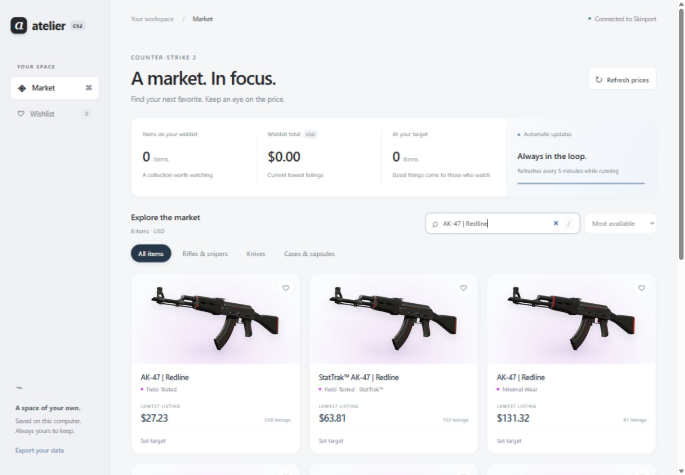

<div align="center">

# Atelier

### A quieter way to watch the CS2 market.

A lightweight, local-first tracker with transparent artwork, a personal wishlist, and automatic price updates.

**No accounts · No API keys · No runtime dependencies · Your data stays local**

</div>



_Actual app screenshot. Prices shown are a snapshot, not current quotes._

## Your next favorites, in focus

- Search skins, cases, stickers, and more; filter categories and sort prices.
- Save a wishlist, set target prices, and see when listings meet your targets.
- Explore transparent artwork with hover tilt, soft shadows, and floating HD previews.
- Build local price-history charts, retaining up to 90 days of observations.
- Refresh Skinport prices every five minutes, even with the browser closed.
- Keep wishlist, targets, price history, and downloaded images on your computer.

Responsive layouts support smaller windows. Reduced-motion preferences disable animation.

## Quick start

Install [Node.js 22 or newer](https://nodejs.org/), then:

```sh
git clone https://github.com/DallenLarson/cs2-atelier.git
cd cs2-atelier
npm start
```

Open **http://127.0.0.1:43127**. No package installation or build step is needed.

The first launch downloads market prices and the artwork catalog. Images load as you browse and cache locally. Fresh data requires an internet connection.

### Windows background mode

Run from PowerShell in the project folder:

```powershell
# Launch quietly and open the app
& '.\Start Atelier.ps1'
# Optional: launch at Windows sign-in
& '.\Enable automatic startup.ps1'
# Stop the background process
& '.\Stop Atelier.ps1'
# Remove automatic sign-in launch
& '.\Disable automatic startup.ps1'
```

Scripts follow your PowerShell execution policy. You can always use `npm start` in a terminal instead. Automatic startup is opt-in for new installations. Keep the project folder in place after enabling it.

Your computer must be awake and online for fresh prices. Offline mode retains the last successful prices and retries automatically. Manual refresh respects the same five-minute interval.

## Local by design

| File                 | Contents                      |
| -------------------- | ----------------------------- |
| `data/wishlist.json` | Saved items and target prices |
| `data/market.json`   | Cached market prices          |
| `data/history.json`  | Price observations            |
| `data/artwork.json`  | Artwork catalog               |
| `data/images/`       | Cached transparent images     |

The `data/` folder, machine-specific shortcuts, and runtime paths are ignored by Git. The server listens only on `127.0.0.1`. No analytics or cloud account is required.

For a complete backup, stop the app and copy `data/`. Restore by stopping the app and replacing that folder with your backup. **Export your data** downloads wishlist and history as JSON; importing that export through the interface is not currently supported.

## What to expect

- Prices are Skinport's lowest tradable listings in **USD**, not Steam wallet prices or completed sales. Missing prices show a dash.
- Target matches appear inside the app; there are no OS push notifications.
- Charts record observations while the process runs. They do not backfill historical data.
- Artwork is a representative 2D render, not a 3D inspection or an exact float/pattern preview. Large previews request 1024 × 768 images where supported.
- Missing artwork falls back to text. Some new items may not have matching images yet.

## Development

Plain HTML, CSS, and JavaScript with a small Node.js server. No framework, bundler, or third-party runtime packages.

```text
server.mjs    Local server, market refresh, persistence
artwork.mjs   Artwork catalog and image cache
public/       Interface, styles, favicon
docs/         README preview
```

GitHub Actions runs these syntax checks:

```sh
node --check server.mjs
node --check artwork.mjs
node --check public/app.js
```

## Sources and credits

[Skinport API](https://docs.skinport.com/items) supplies prices. The [ByMykel CS2 catalog](https://github.com/ByMykel/CSGO-API) maps exact item names to artwork and refreshes daily. Images download from Steam's CDN on demand and stay cached locally.

Your wishlist is not uploaded. Public catalog and image requests contact the relevant providers. CS2 names and artwork belong to their respective owners. This project is not affiliated with Valve or Skinport.
